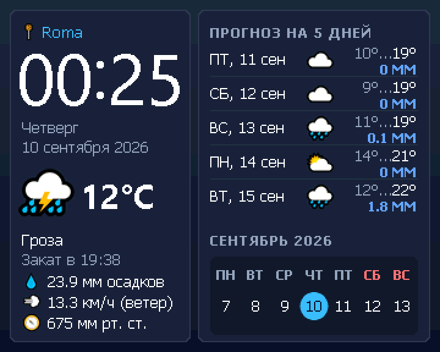

# VDAC4 Weather Saver — заставка Wild Commander с погодой и календарём

<p align="center">
  
</p>
<p align="center"><sub>Кадр из видеопамяти, нарисованный кодом плагина в машинном тесте (увеличен вдвое)</sub></p>

[`build/vdac4/VDAC4WTH.WMF`](build/vdac4/VDAC4WTH.WMF) — экранная заставка для Wild Commander на ZX Evolution
с платой VDAC4 (обмен с ESP32-S3 по SPI). Экран 360×288, 256 цветов (TS-Conf), раскладка по макету
[`index.html`](index.html):

- слева — место, часы с мигающим двоеточием, день недели и дата, текущая
  погода (иконка, температура, описание, время заката), осадки, ветер и
  давление;
- справа — прогноз на 5 дней (день, иконка, минимум…максимум, осадки) и лента
  текущей недели с выделенным сегодняшним днём.

Любая клавиша закрывает заставку; нажатие не доходит до панелей WC.

## Установка

1. Скопируйте `VDAC4WTH.WMF` в каталог `/WC` на SD-карте.
2. В `WC/wc.ini` добавьте строку `VDAC4WTH.WMF` в секцию `[PLUGINS]`, а в
   `[SETUP]` задайте время бездействия `ScreenSaver=1`…`9` (минуты). Wild
   Commander запускает первый в `[PLUGINS]` плагин-заставку (тип `#02`);
   вручную её можно открыть из меню плагинов F10.
3. В `/zifi/zifi.ini` добавьте город — по-английски, в современном написании
   (`Kyiv`, `Odesa`, `Lviv`, `Moscow`, `Rome`), и, чтобы не спутать с
   одноимённым городом другой страны, её код (ISO, две буквы):

   ```ini
   city: Rome
   country: IT
   ```

   На экране — название, которое нашёл геокодер. Город можно написать и
   по-русски (`city: Рим`) — тогда и на экране он будет по-русски.
   Прежняя запись `country:` + `zip:` (почтовый индекс) тоже работает.
4. Нужна прошивка платы VDAC4 из этого репозитория: в ней есть команда
   `WEATHER_GET` с поиском по городу, см. [`Docs/PROTOCOL.md`](../../../Docs/PROTOCOL.md).

Часы и дата берутся из часов Mr.Gluk. Чтобы они шли точно, держите в
`[PLUGINS]` плагин [`VDAC4NTP.WMF`](../NTP%20Time%20Sync/build/vdac4/VDAC4NTP.WMF) — он
сверяет часы с интернетом при запуске WC.

## Откуда погода

Плагин отдаёт ESP файл `zifi.ini` (как и остальные плагины платы) и просит
запись погоды. Всё сетевое делает ESP:

1. город → координаты и название: геокодер Open-Meteo
   (`geocoding-api.open-meteo.com/v1/search?name=…&language=en`, кириллицу —
   с `language=ru`; `country:` добавляет `countryCode`). Без `city:` —
   почтовый индекс в справочнике `api.zippopotam.us/<страна>/<индекс>`. ESP
   помнит координаты, пока ключи места в ini не изменятся, а место, которого
   справочник не знает, повторно не спрашивает;
2. прогноз по готовым координатам: `api.open-meteo.com/v1/forecast`
   (текущая погода и 6 дней, часовой пояс места).

Сервисы бесплатные и без ключа, запросы идут по HTTP и через прокси из
`zifi.ini`, если он задан. Название города в ini может быть в UTF-8, CP866
(редактор Wild Commander) или CP1251 — ESP разберётся сама. Z80 получает
готовую двоичную запись на 90 байт: разбора JSON на Спектруме нет. Украинские
и белорусские буквы Є є Ї ї Ў ў в шрифтах заставки есть (так геокодер
называет маленькие места без английского имени), І і выводятся латинскими I i.

Погода запрашивается при запуске заставки, затем раз в час и при смене дня
(утром строки прогноза сдвигаются). Неудачный повторный запрос не стирает уже
показанную погоду. Если данных нет, вместо погоды выводится причина: «ZiFi не
найден», «Нет /zifi/zifi.ini», «Нет связи Wi-Fi» или «Нет данных о погоде» с
текстом ответа ESP (например, `city: not found` для неизвестного города или
`meteo: http 503`, когда сервер перегружен).

Wi-Fi включает сама заставка: `zifi.ini` уходит ESP командой `WIFI_INI` (раз за
запуск заставки), ESP подключается к сети, ответа заставка ждёт 25 секунд.
После неудачи запрос повторяется через 10, 20, 30, 60 и 120 секунд, дальше —
каждые 5 минут, пока погода не придёт; после удачи снова раз в час. На время
повтора причина стирается и выводится «Запрос погоды…». Сама ESP внутри одной
команды тоже повторяет HTTP-запрос до трёх раз при ответах 5xx/429 и обрыве
связи (ответ 4xx повтором не исправить). Если модуль ZiFi не найден, повторов
нет.
Если `zifi.ini` у ESP уже есть, повтор сразу просит погоду: подключение, не
успевшее к ответу на `WIFI_INI`, ESP доводит сама (прошивка до 0.1.33 на новый
`WIFI_INI` начинала его заново, и медленная точка доступа не подключалась ни с
какого повтора).

## Плата VDAC4

Заставка собирается только для платы VDAC4: обмен с ESP32-S3 по SPI
(`shared/z80/zifi_link.asm` → `zifi_spi.asm`). В меню F10 — `VDAC4 Weather Saver
v0.1`. Собирает её и `build_vdac4.bat` в корне проекта. Сборка для UART
переходника ZiFi (`WEATHER.WMF`) снята.

## Сборка

```bat
"Weather screensaver\build.bat"
```

Нужны Python 3 с Pillow и sjasmplus; общие модули ассемблер берёт из
`shared/z80` и `shared/weather`. `tools/gen_assets.py` растрирует
системные шрифты Windows — Segoe UI для часов и температуры, Tahoma для
текста — без сглаживания, с хинтингом по пиксельной сетке (полутона на
экране 360×288 выглядят размыто), и иконки
Segoe UI Emoji (квантованные в общую палитру), раскладывает их по трём
страницам данных и генерирует `src/*.inc`. Все размеры, цвета и строки
интерфейса — в `tools/design.py`.

## Проверка

```bat
python -m pip install pillow z80
"Weather screensaver\build.bat"
cd "Weather screensaver"
python -m unittest discover -s tests -v
```

Тесты берут собранный `build/vdac4/VDAC4WTH.WMF` и данные генератора, поэтому
сначала нужна сборка. Плагин целиком исполняется в эмуляторе Z80 (пакет `z80`)
на общем с заставкой для VDAC2 стенде
([`shared/weather/harness.py`](../shared/weather/harness.py)) с моделью API
Wild Commander, часов Mr.Gluk и ESP на другом конце канала SPI платы VDAC4
(порты `#57`/`#77`, общий буфер SPI Slave HD и канальный уровень прошивки — та
же модель, что у тестов драйвера, [`tests/spi_link_model.py`](../tests/spi_link_model.py)).
Кадр из видеостраниц сравнивается
попиксельно с эталоном `tools/refscreen.py`, который рисует тот же экран на
Python по тем же данным. Проверяются: полный экран, мигание двоеточия, работа
без ESP, доклад ошибки ESP, часы во время долгого ответа, выход по клавише,
смена дня, обновление раз в час, сохранение погоды при неудачном обновлении,
расписание повторов, повтор после медленного подключения к Wi-Fi (сразу
`WEATHER_GET`, без второго `WIFI_INI`), стирание причины неудачи при повторе и
то, что круг
сегодняшнего дня стоит центром ровно в центре цифр для любого числа месяца.
Часть в прошивке проверяет
[`tests/test_weather_parse.py`](../../Firmware/tests/test_weather_parse.py) в корне
проекта: разбор ответов сервисов — на сохранённых ответах, а службу погоды
целиком — с поддельной сетью (какие запросы уходят, что запоминается, какие
байты названия попадают в запись для Z80).

В эмуляторе Unreal заставка проверяется в режиме платы VDAC4 (ESP за каналом
SPI — программа `tools/unreal/vdac4_esp_host`, сеть и погода настоящие):

```bat
python tools\unreal\prepare_unreal_vdac4.py --fresh-image --media RADIO --weather
```

Скрипт кладёт `VDAC4WTH.WMF` и тестовый `/zifi/zifi.ini` в образ карты и
ставит `ScreenSaver=1`: заставка включается через минуту простоя WC.

## Устройство

| Файл | Назначение |
|---|---|
| `src/main.asm` | вход плагина, подключение модулей |
| `src/screen.asm` | раскладка экрана, зеркало `tools/refscreen.py` |
| `src/gfx.asm`, `src/text.asm` | заливки, панели, иконки, глифы |
| `src/video.asm` | видеорежим и страницы через API WC, палитра |
| `tools/design.py` | цвета, шрифты, раскладка и строки — единый источник |
| `tools/gen_assets.py` | шрифты, иконки, палитра → страницы данных и `src/*.inc` |
| `tools/refscreen.py` | эталон кадра на Python для тестов и `build/preview.png` |
| [`index.html`](index.html) | исходный макет экрана |

Общее с заставкой для VDAC2 ([`VDAC4WT2.WMF`](../Weather%20screensaver%20VDAC2))
лежит в [`shared/weather`](../shared/weather):

| Файл | Назначение |
|---|---|
| `saver.asm` | главный цикл: кадры, часы, повторные запросы; какие процедуры экрана он вызывает |
| `weather.asm` | обмен с ESP: PING, `WIFI_INI`, `WEATHER_GET`; таблица кодов погоды |
| `rtc.asm`, `calendar.asm` | часы Mr.Gluk, дни недели |
| `fmt.asm`, `wc.asm` | числа и строки, переходники API WC |
| `harness.py` | машинный стенд: Z80, модель WC, часов и ESP за каналом SPI |
| `screenshot.png` | снимок экрана для этого описания (`build/test_full_screen.png` ×2) |

Память: код — страница 0 плагина в `#8000`; шрифты и иконки — страницы 1–3,
подключаются к `#0000` (API 78). Экран — первый видеобуфер WC (API 64/65/66),
строка 512 байт, 9 страниц по 32 строки. Палитра (цвета 0–239) пишется в CRAM
через окно FMADDR на `#C000` поверх видеостраницы: запись в окно попадает и в
память под ним, а в `#0000` лежит рабочая страница WC. Цвета 240–255 остаются
за текстовым экраном WC. Режим, банк и палитру при выходе восстанавливает сам
WC (`MNGV_PL` с нулём вызывает `GEDPL`).
