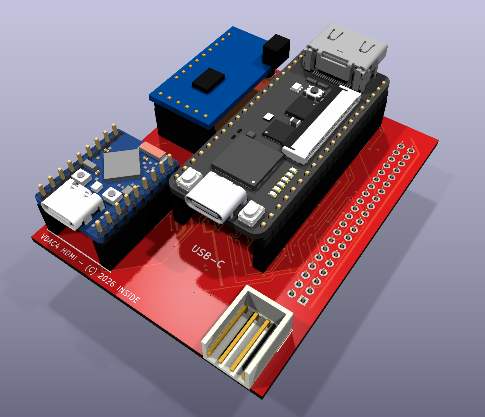

# Плата VDAC4, ревизия A4

Плата-носитель VDAC4 для ZX Evolution (TS-Config): 58×75 мм, 4 слоя. Сверху на гнёздах стоят
Tang Nano 20K (A1), Waveshare ESP32-S3-Zero-N8R8 (A2) и модуль ЦАП GY-PCM5102 (A3); снизу —
гнездо IDE-40 (J1), которым плата надевается прямо на разъём IDE Evo. Питание — от кабеля
питания дисковода (J5). Блок-схема — в [`Docs`](../Docs).

| Папка | Что там |
|---|---|
| [`Docs`](Docs) | PDF: электрическая схема ([`VDAC4_A4_schematic.pdf`](Docs/VDAC4_A4_schematic.pdf), 4 листа), монтажная схема верха и низа ([`VDAC4_A4_assembly.pdf`](Docs/VDAC4_A4_assembly.pdf)), перечень элементов ([`VDAC4_A4_BOM.pdf`](Docs/VDAC4_A4_BOM.pdf)) |
| [`KiCad`](KiCad) | проект KiCad 10: схема (4 листа), плата, библиотека проекта, правила DRC; журнал изменений [`CHANGES_A4.md`](KiCad/CHANGES_A4.md) |
| [`Production`](Production) | комплект для JLCPCB: Gerber и сверловка (`TS_VDAC_A4-A4-gerber.zip`), `JLCPCB_BOM.csv`, `JLCPCB_CPL.csv`, отчёты DRC/ERC, `manifest.json` с SHA-256 файлов и параметрами выгрузки |

## Осторожно

**Установка в IDE-40.** На некоторых версиях ZX Evolution на вывод-ключ IDE-40 (вывод 20)
заведено питание +5 В. На VDAC4 вывод J1.20 ни к чему не подключён, поэтому при правильной
установке это безопасно. Но если надеть плату со сдвигом на один вывод или ряд либо развернуть
её, +5 В попадёт на сигнальную линию или на землю — пострадают буферы платы, модули, а то и Evo.
Ставить плату только при выключенном питании, вывод 1 J1 — к выводу 1 разъёма Evo; перед
включением проверить, что все 40 выводов вошли в гнездо ровно.

**USB-C модулей.** Не подключать кабели USB-C к Tang Nano 20K и ESP32-S3-Zero при включённом
питании ZX Evolution. Прошивать модули по USB — с выключенной Evo или вынув плату из неё.

**Кабель питания +12 В.** Плате нужно только +5 В (J5, вывод 4, красный провод разъёма
дисковода); вывод 1 с +12 В (жёлтый провод) на плате ни к чему не подключён. Гораздо безопаснее
разомкнуть цепь +12 В в самом кабеле, который идёт к плате: тогда ни ошибка в кабеле, ни
неправильно надетый разъём не подадут 12 В на дорогостоящие сборки вроде Tang Nano 20K.

**Перемычка J1 на ZX Evolution должна быть замкнута.** Через неё идёт вывод 1 IDE-40, по
которому на плату приходит выбор ESP32 (`ESP_CS_N`); при разомкнутой J1 ESP со стороны Evo
не откликается.

**Перед первым включением** собранной платы — без модулей Tang, ESP и GY: вставить вилку питания
по ключу и убедиться, что между J5.4 и GND +5 В.

## Перемычки модуля ЦАП JP1–JP4

Четыре открытые паяльные перемычки снизу, под модулем ЦАП, задают выводы настройки
GY-PCM5102. С завода разомкнуты, замыкаются каплей припоя.

| Перемычка | Надпись на плате | Замкнутая соединяет | Что задаёт |
|---|---|---|---|
| JP1 | `FMT=L` | FMT → A_GND | формат I2S |
| JP2 | `XSMT=H` | XSMT → 3,3 В модуля | звук включён |
| JP3 | `DEMP=L` | DEMP → A_GND | коррекция (de-emphasis) выключена |
| JP4 | `FLT=L` | FLT → A_GND | обычный фильтр |

Рабочая настройка — замкнуть все четыре. У самого модуля GY-PCM5102 есть свои площадки H/L для
тех же выводов: уровень задаётся в одном месте — или на плате, или на модуле. **Нельзя** ставить
перемычку на плате и перемычку на модуле в противоположные стороны: это замыкание 3,3 В модуля
на землю.

## Громкость звука JP5, JP6

В каждом канале ЦАП на вход Evo всегда стоит 27 кОм (R17, R18). Трёхконтактные перемычки JP5
(левый канал) и JP6 (правый) снизу у разъёма J2 подключают параллельно ещё один резистор.

| Перемычка | Сопротивление | Размах на выходе Evo | Громче, чем без перемычки |
|---|---|---|---|
| не замкнута | 27k | 1,37 В | 0 дБ |
| середина — «15k» | 27k ∥ 34k = 15,05k | 2,06 В | +3,5 дБ |
| середина — «9k1» | 27k ∥ 13,7k = 9,09k | 2,75 В | +6,0 дБ |

Оба канала замыкать одинаково. Все три площадки сразу не замыкать: вместе с AY звук выйдет за
неискажённый размах микшера Evo. Расчёт — в [`CHANGES_A4.md`](KiCad/CHANGES_A4.md), раздел 3.

## NT1 — связь аналоговой и цифровой земли

NT1 — единственное место, где земля звука (A_GND) соединяется с общей землёй платы. Медные
перемычки между её площадками есть сверху и снизу; площадки 2 мм с отверстиями 1 мм оставлены
под дополнительный провод, если металлизация окажется плохой. NT1 стоит под модулем ЦАП, правее
перемычек JP1–JP4 (надпись `AGND-GND`).

Заливки земли под модулем ЦАП заканчиваются на 2,54 мм выше его ряда цифровых выводов; от этой
линии до ESP32 на всех слоях земли нет, чтобы меньше экранировать антенну Wi-Fi.

## Заказ на JLCPCB

- **Плата:** 4 слоя, 1,6 мм, FR-4, внешняя медь 1 oz, внутренняя 0,5 oz, переходные закрыты
  (Plugged), HASL. Цвет любой.
- **Сборка:** Standard PCBA, обе стороны, технологические поля добавляет JLCPCB (плата меньше
  70×70 мм). «Confirm Parts Placement» стоит включить.
- **Файлы:** `TS_VDAC_A4-A4-gerber.zip` — на шаге платы; `JLCPCB_BOM.csv` и `JLCPCB_CPL.csv` —
  на шаге сборки. Все 24 типа деталей сопоставляются с LCSC автоматически (октябрь 2026).
- Фабрика ставит SMD снизу и выводные разъёмы и гнёзда (J1, J2, J5, J6–J11). Модули Tang, ESP
  и GY-PCM5102 вставляет пользователь. Перемычки JP1–JP6 и провод в NT1 фабрика не запаивает.
- Ориентир (октябрь 2026): 5 плат и сборка 2 из них — около 127 € без доставки и налогов.

## Проверки

ERC — 0 нарушений. DRC — 0 неподключённых, 0 расхождений со схемой; два замечания «PTH внутри
посадочного места A3» (NT1 под модулем ЦАП, который стоит на гнёздах высотой 8,5 мм) внесены
в исключения проекта с комментарием.

3D-модели Tang Nano 20K и ESP32-S3-Zero в комплект не входят (модели производителей): KiCad ищет
их по пути `../../../docs/references/3d-models-20260908/`. Остальные модели — из стандартной
библиотеки KiCad и из `KiCad/Libraries/3D`.
